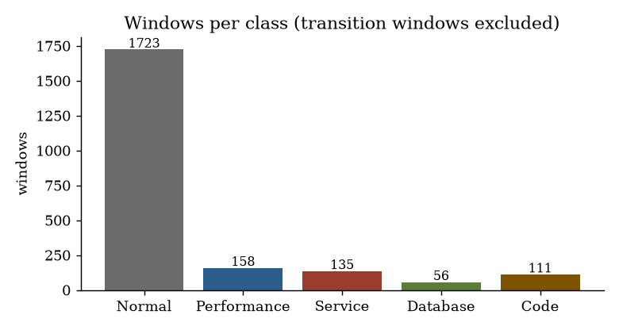
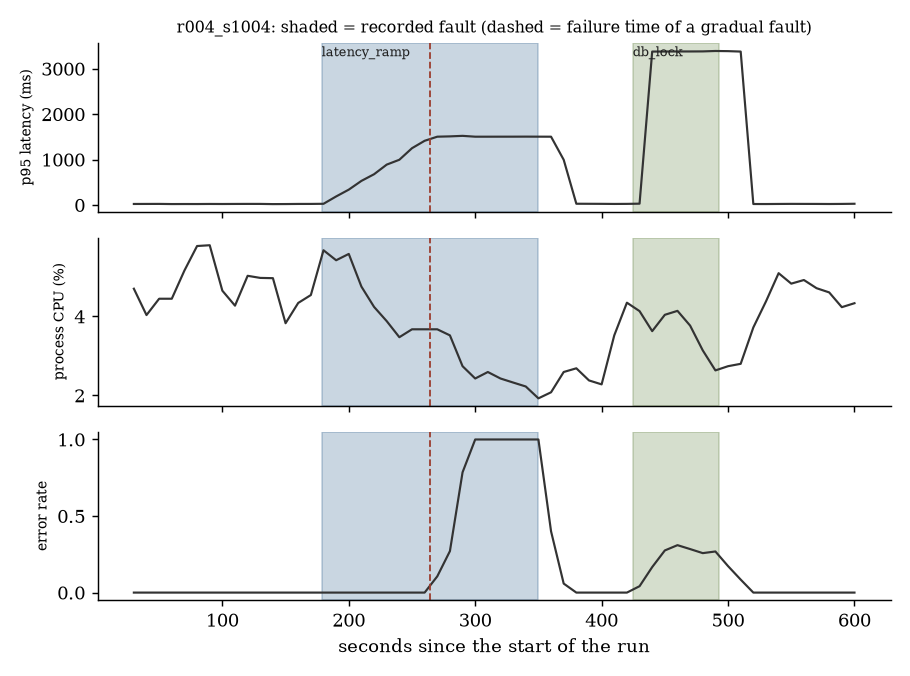
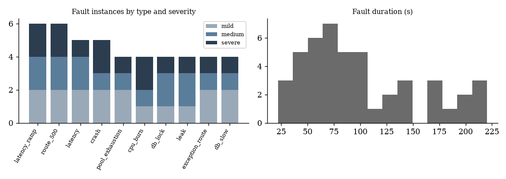
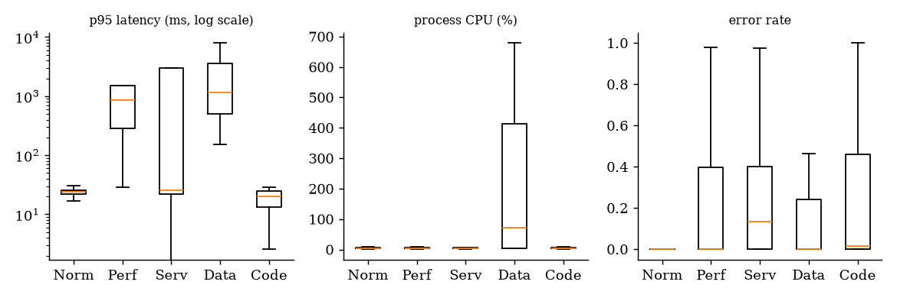

# Testbed dataset

Generated by `python -m testbed.dataset_doc` from the raw events of 40 recorded runs. Every number below is computed from the data.

## What it is

A small real ticket-shop application (FastAPI + SQLite, 5 endpoints: search, book, pay, cancel, health) run on one laptop, monitored only through the `failsight_agent` package, driven by an asyncio load generator, with **real faults injected into the running app at recorded times**. Unlike AnoMod (one label per run, no fault times), every window here can be labelled from an exact fault schedule.

- **Runs:** 40 runs of 10 minutes, one at a time. 10 runs have no fault; the others have 1-3 faults (46 in total). The first 150 s of every run are fault-free.
- **Traffic:** a random profile per run (steady, bursty, ramp, daily-like; steady 14, bursty 7, ramp 5, daily 14 runs), a random request rate (3 to 12 requests per second), and a random mix of user behaviour (browse / purchase / abandon / refund), so that load changes alone are not faults.
- **Faults (10 types, 4 classes):** Performance: `latency`, `cpu_burn`, `latency_ramp` (gradual). Service: `route_500`, `crash`, `pool_exhaustion` (gradual). Database: `db_slow`, `db_lock`. Code: `exception_route`, `leak` (gradual). Each instance has a random severity (mild / medium / severe) drawn from the run's seed and mapped to its parameters (for example latency +30 ms to +800 ms). Gradual faults grow until the app fails at a recorded failure time.
- **Windows:** 30 s long, a new one every 10 s, only windows that lie fully inside the run: 2320 windows (58 per run).

## Features (39 per window, plus 39 baseline-relative versions)

| group | features | names |
|---|---|---|
| api | 8 | `api_request_count`, `api_4xx_count`, `api_5xx_count`, `api_error_rate`, `api_latency_mean_ms`, `api_latency_p95_ms` ... |
| log | 4 | `log_line_count`, `log_error_count`, `log_warning_count`, `log_error_share` |
| process metrics | 19 | `m_process_cpu_percent__mean`, `m_process_cpu_percent__max`, `m_process_cpu_percent__std`, `m_process_rss_bytes__mean`, `m_process_rss_bytes__max`, `m_process_rss_bytes__std` ... |
| changes (against the previous non-overlapping window) | 8 | `d_api_request_count`, `d_api_error_rate`, `d_api_latency_p95_ms`, `d_log_error_count`, `d_m_process_cpu_percent__mean`, `d_m_process_rss_bytes__mean` ... |

The baseline-relative version `rel__<feature>` is a robust z-score against the run's own past only (the last 60 windows that ended before the window began, at least 9; clipped to +-10). No label, no other run and no future window enters it; `python -m testbed.dataset` checks this by overwriting all later windows with garbage (64 windows checked, 0 differences).

## Labels

- `label_level`: **Normal**, or the class of the fault (Performance / Service / Database / Code) that overlaps the window for at least half of it (15 s). `label_binary`: 0 Normal, 1 any fault.
- `fault_type`, `severity_level`, `fault_kind` (abrupt or gradual) and `fault_id` of that fault.
- `transition` = 1 when a fault overlaps the window for less than half: the label is ambiguous. These 137 windows keep the label Normal as specified, are flagged, and are **left out of training and evaluation** (2183 windows remain).
- Gradual faults: `time_to_failure_s` = failure time minus the window end, and `prefail_1m`, `prefail_2m`, `prefail_3m` = the window ends within 1, 2 or 3 minutes before the failure.
- `in_learning` = the window ends within the first 150 s of its run (fault-free by construction).

## Class counts

| class | windows | share | imbalance vs Normal | runs with this class |
|---|---|---|---|---|
| Normal | 1723 | 78.9% | 1 : 1 | 40 |
| Performance | 158 | 7.2% | 10.9 : 1 | 14 |
| Service | 135 | 6.2% | 12.8 : 1 | 13 |
| Database | 56 | 2.6% | 30.8 : 1 | 8 |
| Code | 111 | 5.1% | 15.5 : 1 | 8 |

Binary: Normal 1723, fault 460 (imbalance 3.7 : 1).

By fault type (windows labelled with that type):

| fault_type | fault_kind | windows | instances |
|---|---|---|---|
| cpu_burn | abrupt | 28 | 4 |
| crash | abrupt | 17 | 5 |
| db_lock | abrupt | 23 | 4 |
| db_slow | abrupt | 33 | 4 |
| exception_route | abrupt | 35 | 4 |
| latency | abrupt | 35 | 5 |
| latency_ramp | gradual | 95 | 6 |
| leak | gradual | 76 | 4 |
| pool_exhaustion | gradual | 71 | 4 |
| route_500 | abrupt | 47 | 6 |

By severity level:

| severity_level | windows | instances |
|---|---|---|
| mild | 159 | 17 |
| medium | 156 | 15 |
| severe | 145 | 14 |

Pre-failure targets (gradual faults only):

| target | windows | runs |
|---|---|---|
| pre-failure within 1 min | 84 | 14 |
| pre-failure within 2 min | 168 | 14 |
| pre-failure within 3 min | 252 | 14 |

## Sample rows (2 per class)

| window_id | label_level | fault_type | severity_level | api_request_count | api_error_rate | api_latency_p95_ms | log_error_count | m_process_cpu_percent__mean | m_process_rss_bytes__mean | m_event_loop_lag_ms__mean | m_db_pool_wait_ms__mean |
|---|---|---|---|---|---|---|---|---|---|---|---|
| r016_s1016|49 | Normal |  |  | 390.0 | 0.0 | 19.54 | 0.0 | 4.453 | 29.957 | 19.698 | 0.016 |
| r014_s1014|39 | Normal |  |  | 149.0 | 0.0 | 15.122 | 0.0 | 4.047 | 29.357 | 20.721 | 0.016 |
| r003_s1003|41 | Performance | latency | mild | 272.0 | 0.0 | 322.769 | 0.0 | 6.72 | 54.34 | 21.315 | 0.066 |
| r022_s1022|51 | Performance | latency_ramp | medium | 93.0 | 1.0 | 1507.121 | 97.0 | 2.964 | 38.711 | 14.815 | 0.0 |
| r009_s1009|22 | Service | route_500 | severe | 88.0 | 0.216 | 26.049 | 19.0 | 3.633 | 55.183 | 20.454 | 0.014 |
| r008_s1008|40 | Service | crash | severe | 0.0 | 0.0 | 0.0 | 0.0 | nan | nan | nan | nan |
| r029_s1029|31 | Database | db_slow | medium | 293.0 | 0.0 | 705.327 | 0.0 | 520.36 | 32.727 | 20.32 | 13.105 |
| r004_s1004|43 | Database | db_lock | medium | 113.0 | 0.31 | 3380.503 | 37.0 | 4.14 | 56.043 | 18.768 | 8.134 |
| r032_s1032|31 | Code | exception_route | medium | 212.0 | 0.514 | 16.004 | 0.0 | 8.386 | 56.82 | 21.252 | 0.021 |
| r019_s1019|51 | Code | leak | medium | 58.0 | 1.0 | 2.67 | 58.0 | 3.373 | 388.47 | 17.901 | 0.0 |

## Limits

One application, one machine, synthetic traffic and faults injected by us: the data show what the monitor can see in this app, not in production systems. Windows overlap by 20 s, so neighbouring windows are not independent; all validation therefore splits by whole run. The fault effects are real (the app sleeps, burns CPU, fails, locks its database, leaks memory) but they are the effects we chose to implement.
